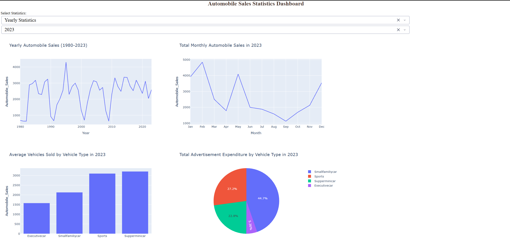

# Automobile Sales Statistics Dashboard

An interactive dashboard built with **Plotly Dash** that explores historical automobile sales from 1980 to 2023, with a focus on how sales, advertising spend and unemployment behave during recession periods.



## Features

The dashboard has two report types, chosen from a dropdown.

### Yearly Statistics
Pick a year (1980-2023) to see:
- Average automobile sales per year across the full 1980-2023 period (line chart)
- Total monthly sales for the selected year (line chart)
- Average vehicles sold by vehicle type in the selected year (bar chart)
- Total advertising expenditure by vehicle type in the selected year (pie chart)

### Recession Period Statistics
Filters the data to recession periods and shows:
- Average sales fluctuation over the recession years (line chart)
- Average vehicles sold by vehicle type (bar chart)
- Share of advertising expenditure by vehicle type (pie chart)
- Effect of unemployment rate on sales, split by vehicle type (stacked bar chart)

The year dropdown is only enabled for Yearly Statistics, handled through Dash callbacks.

## Tech Stack

- Python
- Dash (layout and callbacks)
- Plotly Express (charts)
- pandas (data processing)

## Getting Started

```bash
git clone https://github.com/Piyush12112001/automobile-sales-dashboard.git
cd automobile-sales-dashboard
pip install -r requirements.txt
python dashboard.py
```

Then open http://127.0.0.1:8050 in your browser.

The app loads the dataset (`historical_automobile_sales.csv`) directly from a public URL, so an internet connection is required.

## Project Structure

```
.
├── dashboard.py        # Dash app: layout, callbacks, charts
├── requirements.txt
├── screenshots/
└── README.md
```

## Acknowledgements

Built as part of IBM's *Data Visualization with Python* course on Skills Network. The dataset is provided by the course.
